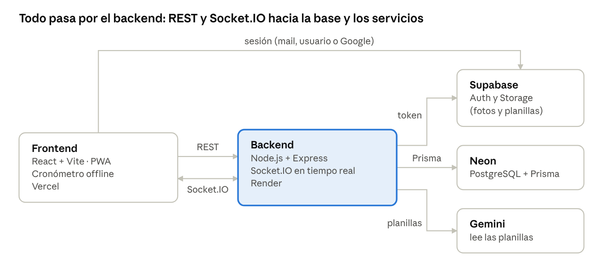

# Documentación técnica — Dodgeball BA Cronómetro

## Arquitectura

Son dos programas separados, el frontend en Vercel y el backend en Render, que usan una base en Neon, autenticación en Supabase y Gemini para las planillas.

arquitectura · 5 componentes

El frontend pide datos por REST, recibe el reloj en vivo por Socket.IO y obtiene la sesión de Supabase; el backend valida ese token, guarda con Prisma en Neon y usa Gemini para leer las planillas de juego.

## Cómo levantar el proyecto

Hacen falta Git y Node 24 (LTS); el backend corre en el puerto 3001 y el frontend en el 5173, cada uno en su propia terminal.

1.  Clonar el repositorio: git clone https://github.com/matycody/dodgeball-ba.git y entrar a la carpeta.

2.  Backend: cd backend, npm install, crear backend/.env (ver Variables de entorno), npx prisma generate y npm run dev.

3.  Frontend: en otra terminal, cd frontend, npm install, crear frontend/.env.local y npm run dev.

4.  Verificar: http://localhost:3001/health responde {"status":"ok"} y, en http://localhost:5173, la consola del navegador muestra \[socket\] conectado.

Si la base de Neon es nueva y está vacía, parado en backend/: primero npx prisma migrate deploy y después npm run seed, que crea los administradores de ADMIN_EMAILS. No correr esos comandos contra una base ya migrada y compartida sin backup previo.

La PWA solo existe en el build: para probarla, npm run build y npm run preview en frontend/.

| Carpeta  | Script                          | Qué hace                                                                               |
|----------|---------------------------------|----------------------------------------------------------------------------------------|
| backend  | npm run dev / npm start         | Levanta el servidor (node server.js)                                                   |
| backend  | npm run seed                    | Crea los administradores iniciales                                                     |
| backend  | npm run smoke                   | Más de 130 chequeos contra un backend en marcha; crea y borra usuarios de prueba SMOKE |
| backend  | npm test                        | Tests unitarios con Vitest (motor de timers y partidos extra)                          |
| frontend | npm run dev                     | Servidor de desarrollo de Vite                                                         |
| frontend | npm run build / npm run preview | Compila y sirve el build (PWA)                                                         |
| frontend | npm run lint                    | ESLint                                                                                 |
| frontend | npm run test:e2e                | Pruebas E2E con Playwright                                                             |

## Variables de entorno

Solo seis variables del backend y tres del frontend son obligatorias; el resto tiene un valor por defecto. Ninguna va en git: el backend las lee de backend/.env (o del panel de Render) y el frontend de frontend/.env.local (o del panel de Vercel).

### Backend

| Variable                  | Obligatoria             | Para qué sirve                                                                               | Por defecto                            |
|---------------------------|-------------------------|----------------------------------------------------------------------------------------------|----------------------------------------|
| PORT                      | No                      | Puerto del servidor                                                                          | 3001                                   |
| DATABASE_URL              | Sí                      | Connection string de Neon con ?sslmode=require; directa en local, con host -pooler en Render | —                                      |
| SUPABASE_URL              | Sí                      | URL del proyecto de Supabase                                                                 | —                                      |
| SUPABASE_ANON_KEY         | Sí                      | Clave anon de Supabase                                                                       | —                                      |
| SUPABASE_SERVICE_ROLE_KEY | Sí                      | Clave service_role; secreta, solo en el backend                                              | —                                      |
| ADMIN_EMAILS              | Sí                      | Mails de los administradores iniciales, separados por coma                                   | —                                      |
| GEMINI_API_KEY            | Solo planillas de juego | Clave para leer planillas con Gemini                                                         | —                                      |
| GEMINI_MODEL              | No                      | Modelo principal de lectura de planillas                                                     | gemini-3.8-flash                       |
| GEMINI_FALLBACK_MODELS    | No                      | Modelos alternativos, separados por coma                                                     | gemini-3.5-flash,gemini-3.5-flash-lite |
| SENTRY_DSN                | No                      | Monitoreo de errores; sin ella Sentry queda apagado                                          | —                                      |
| SENTRY_TEST_KEY           | No                      | Clave de la ruta de prueba de Sentry; borrarla después de probar                             | —                                      |
| NODE_ENV                  | No                      | Entorno que se informa a Sentry                                                              | production                             |
| MICROCACHE_TTL_MS         | No                      | Duración del microcaché de los GET públicos                                                  | 5000                                   |
| MEMO_TTL_MS               | No                      | Duración de la memoización de consultas                                                      | 5000                                   |
| TABLE_LOCK_GRACE_MS       | No                      | Tiempo que espera el bloqueo de mesa antes de liberarse tras una desconexión                 | 15000                                  |
| MAX_CONN_PER_IP           | No                      | Máximo de conexiones de socket por IP                                                        | 200                                    |
| BASE_URL                  | No                      | URL del backend que usa npm run smoke                                                        | http://localhost:3001                  |

### Frontend

| Variable                              | Obligatoria | Para qué sirve                                                         |
|---------------------------------------|-------------|------------------------------------------------------------------------|
| VITE_BACKEND_URL                      | Sí          | URL del backend (REST y Socket.IO); sin ella usa http://localhost:3001 |
| VITE_SUPABASE_URL                     | Sí          | Misma URL de Supabase que el backend                                   |
| VITE_SUPABASE_ANON_KEY                | Sí          | Clave anon; nunca la service_role                                      |
| VITE_SENTRY_DSN                       | No          | DSN completo de Sentry (con la clave antes de la @)                    |
| E2E_BASE_URL, E2E_EMAIL, E2E_PASSWORD | No          | Solo para Playwright: URL a probar y una cuenta de prueba real         |

Vite inyecta las variables VITE\_ al compilar: si se cambia una en Vercel hay que hacer Redeploy, no alcanza con guardarla.

## Endpoints de la API REST

La API tiene 153 endpoints: 27 públicos, 24 con sesión, 10 que además piden permiso sobre el partido y 92 solo para la organización. La autenticación es Authorization: Bearer \<access_token de Supabase\>; sin permiso responde 403 Sin permiso. Los GET públicos tienen un microcaché de 5 s y el límite es de 1000 pedidos por minuto por IP.

Acceso: **Pública** (sin sesión; en algunas la sesión es opcional), **Sesión** (cualquier persona logueada), **Partido** (sesión y ser mesa, árbitro u organización de ese partido) y **Organización** (rol ADMIN).

La rama docs/api-sprint4 tiene un OpenAPI y una colección de Postman del 31/10 (121 operaciones), pero no incluyen lo cargado después: quita de puntos a equipos, sanciones sin partido, Prode, Ranking, /me/stats ni /sanciones-publicas. Esta tabla sale del código de la rama main.

### Cuenta y sesión

| Método | Ruta            | Acceso  |
|--------|-----------------|---------|
| POST   | /auth/login     | Pública |
| GET    | /me             | Sesión  |
| PATCH  | /me/username    | Sesión  |
| GET    | /me/assignments | Sesión  |
| GET    | /me/stats       | Sesión  |
| GET    | /me/profile     | Sesión  |
| PATCH  | /me/profile     | Sesión  |
| PUT    | /me/photo       | Sesión  |
| GET    | /me/photo       | Sesión  |
| DELETE | /me/photo       | Sesión  |
| DELETE | /me             | Sesión  |

### Fotos y escudos

| Método      | Ruta                             | Acceso       |
|-------------|----------------------------------|--------------|
| POST        | /photos/sign                     | Sesión       |
| PUT, DELETE | /photos/profiles/:id             | Organización |
| PUT, DELETE | /photos/teams/:id                | Organización |
| PUT, DELETE | /photos/teams/:id/branch/:branch | Organización |
| PUT, DELETE | /photos/tournaments/:id          | Organización |
| PUT         | /photos/news-image               | Organización |

### Personas, solicitudes y usuarios

| Método             | Ruta                         | Acceso       |
|--------------------|------------------------------|--------------|
| POST, GET          | /profiles                    | Organización |
| GET, PATCH, DELETE | /profiles/:id                | Organización |
| POST               | /profiles/:id/unlink         | Organización |
| POST               | /player-requests             | Sesión       |
| GET                | /player-requests/mine        | Sesión       |
| GET                | /player-requests             | Organización |
| POST               | /player-requests/:id/approve | Organización |
| POST               | /player-requests/:id/reject  | Organización |
| GET                | /users                       | Organización |
| POST               | /users/:id/promote           | Organización |
| POST               | /users/:id/demote            | Organización |
| POST, DELETE       | /users/:id/referee           | Organización |
| POST               | /users/:id/reactivate        | Organización |
| DELETE             | /users/:id                   | Organización |

### Equipos, jugadores y sedes

| Método        | Ruta                          | Acceso       |
|---------------|-------------------------------|--------------|
| GET           | /teams                        | Pública      |
| GET           | /teams/:id                    | Pública      |
| GET           | /teams/:id/posiciones         | Pública      |
| GET           | /players/:id                  | Pública      |
| POST          | /teams                        | Organización |
| PATCH, DELETE | /teams/:id                    | Organización |
| POST          | /teams/:id/players            | Organización |
| DELETE        | /teams/:id/players/:profileId | Organización |
| PUT           | /teams/:id/coach              | Organización |
| GET           | /venues/public                | Pública      |
| GET, POST     | /venues                       | Organización |
| POST          | /venues/resolve               | Organización |
| PATCH, DELETE | /venues/:id                   | Organización |

### Torneos

Podio (Sprint 4): PUT /tournaments/:id/podium guarda el 2.º y 3.º puesto a mano (second, third); el cierre del torneo acepta secondId y thirdId. El podio se resuelve en services/podium.js con esta prioridad: manual, partidos de final y 3.º puesto, tabla de la liga (solo posiciones sin empate). GET /tournaments/:id devuelve el escudo del campeón.

| Método        | Ruta                                                  | Acceso       |
|---------------|-------------------------------------------------------|--------------|
| GET           | /tournaments                                          | Pública      |
| GET           | /tournaments/eligible-teams                           | Pública      |
| GET           | /tournaments/:id                                      | Pública      |
| GET           | /tournaments/:id/standings                            | Pública      |
| GET           | /tournaments/:id/final-standings                      | Pública      |
| POST          | /tournaments                                          | Organización |
| PATCH, DELETE | /tournaments/:id                                      | Organización |
| PUT           | /tournaments/:id/teams                                | Organización |
| PUT           | /tournaments/:id/stages                               | Organización |
| PATCH         | /tournaments/:id/stages/:stageId                      | Organización |
| POST          | /tournaments/:id/activate                             | Organización |
| POST          | /tournaments/:id/close                                | Organización |
| POST          | /tournaments/:id/pause                                | Organización |
| POST          | /tournaments/:id/resume                               | Organización |
| POST          | /tournaments/:id/reset                                | Organización |
| POST          | /tournaments/:id/restore                              | Organización |
| DELETE        | /tournaments/:id/purge                                | Organización |
| POST          | /tournaments/:id/stages/:stageId/penalties            | Organización |
| DELETE        | /tournaments/:id/stages/:stageId/penalties/:penaltyId | Organización |

### Fixture y llaves

Novedades Sprint 4: POST /tournaments/:id/stages/:stageId/fixture acepta time (HH:MM, hora Argentina) y court (1 a 50) opcionales en el sorteo; hay altas y bajas de fechas (matchdays) y PUT /tournaments/:id/matchdays/:matchdayId/order para reordenar. PATCH /matches/:id con matchdayId mueve un partido de fecha (solo SCHEDULED o READY). Al crear un partido, un equipo repetido en la misma fecha devuelve TEAM_IN_FECHA y un cruce ya existente en la zona devuelve REPEATED_PAIR, que se confirma reenviando con force. POST /tournaments/:id/structure actualiza en el lugar si la estructura no cambió o solo se agregan llaves, sin borrar el fixture.

| Método            | Ruta                                                                 | Acceso       |
|-------------------|----------------------------------------------------------------------|--------------|
| GET               | /tournaments/:id/matchdays                                           | Pública      |
| GET               | /tournaments/:id/extra-matches                                       | Pública      |
| GET               | /tournaments/:id/stages/:stageId/bracket                             | Pública      |
| POST, DELETE      | /tournaments/:id/stages/:stageId/fixture                             | Organización |
| PATCH             | /tournaments/:id/matchdays/:matchdayId                               | Organización |
| PUT               | /tournaments/:id/matchdays/:matchdayId/order                         | Organización |
| POST              | /tournaments/:id/matchdays/:matchdayId/assign-courts                 | Organización |
| POST, PUT, DELETE | /tournaments/:id/stages/:stageId/bracket                             | Organización |
| PATCH             | /tournaments/:id/stages/:stageId/bracket/rounds/:round               | Organización |
| POST              | /tournaments/:id/stages/:stageId/bracket/rounds/:round/assign-courts | Organización |

### Partidos y planillas

| Método        | Ruta                                       | Acceso                    |
|---------------|--------------------------------------------|---------------------------|
| GET           | /matches                                   | Pública (sesión opcional) |
| GET           | /matches/:id                               | Pública (sesión opcional) |
| GET           | /matches/:id/sanctions                     | Pública (sesión opcional) |
| GET           | /matches/:id/suspended                     | Pública (sesión opcional) |
| GET           | /matches/:id/staff                         | Pública (sesión opcional) |
| GET           | /matches/:id/attendance                    | Pública (sesión opcional) |
| POST          | /matches/:id/ready, /unready, /finish      | Partido                   |
| POST          | /matches/:id/sets                          | Partido                   |
| PATCH, DELETE | /matches/:id/sets/:number                  | Partido                   |
| GET           | /matches/:id/sheet                         | Partido                   |
| POST          | /matches/:id/sheet/photo                   | Partido                   |
| POST          | /matches/:id/sheet/:sheetId/confirm        | Partido                   |
| POST          | /matches/:id/sheet/reject                  | Partido                   |
| POST          | /matches                                   | Organización              |
| PATCH         | /matches/:id                               | Organización              |
| POST          | /matches/bulk-schedule                     | Organización              |
| POST          | /matches/:id/cancel, /suspend, /reschedule | Organización              |
| PATCH         | /matches/:id/reason                        | Organización              |
| POST          | /matches/:id/hide, /restore                | Organización              |
| DELETE        | /matches/:id/purge                         | Organización              |
| POST          | /matches/:id/assignments                   | Organización              |
| DELETE        | /matches/:id/assignments/:assignmentId     | Organización              |
| GET           | /matches/:id/result-log                    | Organización              |
| GET           | /matches/:id/sheets                        | Organización              |
| GET           | /sheets, /sheets/:matchId                  | Organización              |

### Sanciones

| Método      | Ruta                                  | Acceso       |
|-------------|---------------------------------------|--------------|
| GET         | /sanciones-publicas                   | Sesión       |
| GET         | /sanctions/reds, /reds/count, /active | Organización |
| GET, POST   | /sanctions/standalone                 | Organización |
| DELETE      | /sanctions/standalone/:id             | Organización |
| PUT, DELETE | /sanctions/:id/suspension             | Organización |
| GET         | /sanctions/team-penalties             | Organización |

### Prode, favoritos, búsqueda, noticias y estadísticas

| Método        | Ruta                                                                    | Acceso                    |
|---------------|-------------------------------------------------------------------------|---------------------------|
| GET           | /predictions/open, /matches, /match/:matchId, /ranking, /me             | Sesión                    |
| POST          | /predictions                                                            | Sesión                    |
| DELETE        | /predictions/match/:matchId                                             | Sesión                    |
| GET, POST     | /favorites                                                              | Sesión                    |
| DELETE        | /favorites/:type/:id                                                    | Sesión                    |
| GET           | /search                                                                 | Pública (sesión opcional) |
| GET           | /news, /news/:id                                                        | Pública                   |
| POST          | /news                                                                   | Organización              |
| PATCH, DELETE | /news/:id                                                               | Organización              |
| GET           | /stats/champions, /stats/teams/:id, /stats/head-to-head, /stats/records | Pública                   |

### Auditoría y sistema

| Método | Ruta                                  | Acceso                       |
|--------|---------------------------------------|------------------------------|
| GET    | /audit, /audit/roster, /audit/summary | Organización                 |
| GET    | /health                               | Pública                      |
| GET    | /time                                 | Pública                      |
| GET    | /debug-sentry                         | Con la clave SENTRY_TEST_KEY |

### Reportes de problemas

Cualquier persona envía un reporte (con o sin cuenta) y solo la organización lo lee. Las capturas van a un bucket privado de Supabase (bug-reports, se crea solo en la primera subida) y se ven con URL firmadas de 1 hora.

| Método | Ruta                             | Acceso                                                                  |
|--------|----------------------------------|-------------------------------------------------------------------------|
| POST   | /reports                         | Pública (con o sin sesión), 8 por hora por IP                           |
| POST   | /reports/:id/images?key=         | Con la clave que devuelve el alta, hasta 3 capturas, 30 por hora por IP |
| GET    | /reports (filtros status y kind) | Organización                                                            |
| GET    | /reports/new-count               | Organización (burbuja del menú)                                         |
| PATCH  | /reports/:id                     | Organización (estado y nota interna)                                    |
| DELETE | /reports/:id                     | Organización (borra también las capturas)                               |

El alta devuelve id y uploadKey; la clave solo sirve para subir capturas a ese reporte (comparación en tiempo constante) y las imágenes se pasan a WebP de hasta 1280 px. El frontend suma solo la pantalla anterior, el tamaño de la ventana y hasta 5 errores de consola (lib/reportContext.js); el mail de contacto solo se guarda si no hay sesión.

## Eventos Socket.IO

El reloj se sincroniza por Socket.IO con eventos de prefijo match:; el token de Supabase, si hay sesión, viaja en socket.handshake.auth.token. Hay tres salas: la pública match:\<id\> (cualquiera ve el reloj), la de control control:\<id\> (mesa, árbitro y organización del partido) y el feed matches:subscribe, que avisa cambios de todos los partidos. Cada conexión puede estar en hasta 12 salas y cada IP tiene un máximo de conexiones (MAX_CONN_PER_IP).

### El cliente emite

| Evento                                                       | Sala    | Para qué sirve                                                                            |
|--------------------------------------------------------------|---------|-------------------------------------------------------------------------------------------|
| match:join / match:leave                                     | Pública | Seguir un partido (con { matchId }); al unirse recibe el último match:tick                |
| matches:subscribe / matches:unsubscribe                      | Feed    | Recibir match:updated de todos los partidos                                               |
| match:controlJoin / match:controlLeave                       | Control | Entrar a operar el partido; el servidor valida la asignación y devuelve match:permissions |
| match:start, match:pause, match:resume, match:reset          | Control | Operar el reloj; pausa y reanudación aceptan alcance de grupo (scope, target)             |
| match:adjust, match:setTime                                  | Control | Corregir el tiempo del partido o del set                                                  |
| match:setModality, match:setHalf, match:finishHalf           | Control | Cambiar modalidad (Foam o Cloth) y pasar de tiempo                                        |
| match:timeout:start, match:timeout:end, match:timeout:cancel | Control | Tiempo muerto: iniciar, terminar o deshacer uno pedido por error                          |
| match:sanction:add, match:sanction:remove                    | Control | Cargar o deshacer una advertencia, amarilla, azul o roja                                  |

### El servidor emite

| Evento                       | Sala                  | Contenido                                                                                                                             |
|------------------------------|-----------------------|---------------------------------------------------------------------------------------------------------------------------------------|
| match:tick                   | Pública               | Estado del reloj: matchTime, setTime, isMatchPaused, isSetPaused, matchHalf, timeoutTime, timeoutTeam, isTimeoutRunning, timeoutsUsed |
| match:setExpired             | Pública               | Venció el set: modality, action y message (Foam: muerte súbita; Cloth: set finalizado)                                                |
| match:timeoutExpired         | Pública               | Venció el tiempo muerto de un equipo (team, message)                                                                                  |
| match:finished               | Pública               | Terminó el tiempo del partido; solo congela el reloj, el estado FINISHED lo pone la mesa                                              |
| match:paused / match:resumed | Pública               | Pausa o reanudación, con matchId (uno o varios), scope y target                                                                       |
| match:updated                | Pública y feed        | Cambió el partido (torneo, cancha, sede, rama, modalidad, marcador)                                                                   |
| match:permissions            | Quien entra a control | Qué puede hacer: isTable, isReferee, tableLockedBy, canControlClock, canReady, canUnready, canAddSets, canEditResult, canFinish       |
| match:action                 | Control               | Quién hizo qué (por ejemplo "Pausado por Pérez"), con action, by y at                                                                 |
| match:tableFree              | Control               | La mesa quedó libre: la persona que la tenía salió o se desconectó 15 s                                                               |
| match:error                  | Quien lo originó      | Error con matchId y message (partido inexistente, sin asignación, demasiadas salas)                                                   |

Si Render se reinicia, el reloj se recupera desde la tabla MatchClock en pausa y la mesa lo reanuda a mano.

## Modelo de datos

Nuevo en Sprint 4: TournamentPlace (PK torneo + puesto, equipo, borrado en cascada con el torneo) guarda los puestos 2.º y 3.º elegidos a mano. Migración 20261105160000_tournament_places: como Render solo corre npm install, hay que aplicarla a mano con npx prisma migrate deploy y npx prisma generate.

También nuevo: BugReport (tipo ReportKind: ERROR, VISUAL, SUGGESTION, OTHER; estado ReportStatus: NEW, IN_REVIEW, RESOLVED, DISCARDED) guarda cada reporte de problema con el texto, la pantalla, el dispositivo, los últimos errores de consola, el usuario (opcional, SetNull si se borra la cuenta), las rutas de las capturas, una clave de subida y la nota interna de la organización. Migración 20261107120000_bug_reports.

El esquema de Prisma (backend/prisma/schema.prisma, PostgreSQL en Neon) tiene 33 modelos. La cadena principal es Torneo → Etapa (zona o llave) → Fecha → Partido, y de cada Partido cuelgan sets, asignaciones, reloj, sanciones y predicciones.

Enumeraciones: Role (ADMIN, REFEREE, PLAYER), Branch (MIXED, MALE, FEMALE), Modality (FOAM, CLOTH), MatchStatus (SCHEDULED, READY, LIVE, FINISHED, CANCELLED, SUSPENDED), MatchFunction (REFEREE, TABLE), TournamentFormat (LEAGUE, LEAGUE_CUP, CUP), TournamentStatus (DRAFT, ACTIVE, FINISHED), StageType (LEAGUE, KNOCKOUT), SanctionKind (WARNING, YELLOW, BLUE, RED) y TiebreakerCriterion (HEAD_TO_HEAD, SET_DIFFERENCE, SETS_WON, WINS, DRAW_LOT).

| Dominio    | Modelo                                | Qué guarda                                                                                                                                                          |
|------------|---------------------------------------|---------------------------------------------------------------------------------------------------------------------------------------------------------------------|
| Cuentas    | User                                  | Cuenta de Supabase (supabaseId), mail, usuario, roles, foto y si está activa; tiene como máximo un Profile                                                          |
| Cuentas    | Profile                               | Persona de la planilla: DNI, nombre, sexo, apodo, número, privacidad del banner y estado (PENDIENTE_VINCULACION o VINCULADO)                                        |
| Cuentas    | PlayerRequest, PlayerRequestTeam      | Pedido de alta como jugador (PENDING, APPROVED, REJECTED) con los equipos y ramas elegidos                                                                          |
| Cuentas    | Favorite, AuditLog                    | Favoritos por usuario (equipo, jugador o torneo) y registro de quién ejecutó cada operación de escritura                                                            |
| Equipos    | Team, TeamBranch, TeamModality        | Equipo con nombre, escudo, apodo, ciudad y año; ramas (cada una con su escudo) y modalidades en las que juega                                                       |
| Equipos    | PlayerTeam                            | Pertenencia de un Profile a un Team por rama, con fecha de inicio y fin, y si es DT                                                                                 |
| Equipos    | Venue                                 | Sede: dirección, coordenadas, enlace al mapa y cantidad de canchas                                                                                                  |
| Torneos    | Tournament                            | Nombre, año, edición, rama, modalidad, formato, nombre propio del formato, estado, puntos por resultado, campeón, logo, pausa y baja lógica                         |
| Torneos    | TournamentTeam, Tiebreaker            | Equipos inscriptos y criterios de desempate en orden                                                                                                                |
| Torneos    | Stage, StageTeam, Matchday            | Zona o llave con su categoría y cupos de ascenso y descenso; sus equipos (con ronda de ingreso) y las fechas del fixture                                            |
| Torneos    | StageStanding, TeamPenalty            | Tabla de posiciones de la zona y quitas de puntos a un equipo (puntos, motivo y faltantes)                                                                          |
| Partidos   | Match                                 | Torneo, zona, fecha, equipos A y B, cancha, sede, horario, estado, motivo, posición en la llave (round, slot, nextMatchId, loserMatchId) y si está oculto por pausa |
| Partidos   | MatchAssignment                       | Árbitro o mesa asignado a una persona, un usuario o un equipo completo                                                                                              |
| Partidos   | MatchSet, ClockAction, MatchResultLog | Sets ganados con su momento, acciones del reloj y su autor, e historial de ediciones del resultado                                                                  |
| Partidos   | MatchClock                            | Estado del reloj guardado para recuperarlo tras un reinicio del servidor                                                                                            |
| Partidos   | MatchSheet, MatchAttendance           | Foto de la planilla de juego (con lectura por IA y confirmación) y asistencia de jugadores                                                                          |
| Disciplina | MatchSanction                         | Advertencia, amarilla, azul o roja a un jugador: lado, set, minuto y si lo elimina                                                                                  |
| Disciplina | PlayerSuspension                      | Suspensión por una roja o sin partido: fechas, mismo día, alcance, modalidades y categorías, torneo opcional                                                        |
| Contenido  | News, Prediction                      | Noticias con portada y predicciones del Prode (elección, cuota, bonus, puntos y anulación)                                                                          |

## Despliegue y migraciones

Cada merge a main redeploya solo el backend en Render y el frontend en Vercel; las migraciones de la base no son automáticas y se aplican a mano, con backup previo.

| Servicio | Qué aloja                     | Configuración clave                                                                                                                                  |
|----------|-------------------------------|------------------------------------------------------------------------------------------------------------------------------------------------------|
| Neon     | PostgreSQL                    | Una rama de desarrollo (dev-torneos) y otra de producción (hoy es una copia de la de desarrollo); en local, host directo y en Render, host -pooler   |
| Render   | Backend (Express y Socket.IO) | Root Directory backend, build npm install, start npm start, rama main; el plan gratuito duerme sin tráfico y la primera respuesta tarda unos 30 s    |
| Vercel   | Frontend (Vite, PWA)          | Root Directory frontend, vercel.json reenvía toda ruta a index.html, VITE_BACKEND_URL apuntando a Render; plan Hobby con tope de 100 deploys por día |
| Supabase | Auth y Storage                | Fotos, escudos y planillas; en las URLs de redirección incluir /recuperar                                                                            |

El CORS de Express y de Socket.IO tiene que incluir la URL del frontend; si falta, el socket no conecta en producción y el error solo se ve en la consola del navegador.

### Publicar un cambio

1.  Trabajar en una rama feature/..., nunca directo en main ni en develop.

2.  Abrir un PR a main: necesita la aprobación de otro integrante.

3.  Al hacer merge, Render y Vercel redeployan.

4.  En Vercel, confirmar que el deployment nuevo esté promovido a Production y no solo en estado Ready.

### Aplicar migraciones

1.  Hacer un backup en Neon justo antes (rama o punto de restauración).

2.  Con DATABASE_URL apuntando a la base destino, correr en backend/: npx prisma migrate deploy y npx prisma generate. Aplica en orden todas las pendientes; la última es 20261107120000_bug_reports.

3.  Reiniciar el backend y buscar en el log de Render \[clock\] relojes recuperados: N.

4.  Probar en la app real antes de dar por cerrado el despliegue.

URLs públicas de producción: frontend https://dodgeball-ba.vercel.app y backend dodgeball-ba.onrender.com. En backend/scripts hay tres utilidades: copiar-bd.js (copia los datos de una base Neon a otra) y cargar-torneos.js (carga de una vez los torneos del Nacional 2026: crea los torneos y los equipos que falten, con fixture, resultados y llaves; admite --solo "texto"); fusionar-equipos.js une equipos duplicados pasando todo al que se conserva; las tres simulan por defecto y solo escriben con --aplicar.

## Monitoreo de errores (Sentry)

El código ya está integrado y se activa solo si existe el DSN: backend/instrument.js (@sentry/node, errores 5xx de Express y errores de sockets) y frontend/src/main.jsx (@sentry/react, con ErrorBoundary). Solo se envían errores: tracesSampleRate: 0 y sendDefaultPii: false. Cada evento lleva el release (commit de Render RENDER_GIT_COMMIT y de Vercel VERCEL_GIT_COMMIT_SHA, expuesto como VITE_RELEASE).

Variables: SENTRY_DSN y SENTRY_TEST_KEY en el backend (Render), VITE_SENTRY_DSN en el frontend (Vercel). Para probar: /debug-sentry?key=\<SENTRY_TEST_KEY\> y \_\_sentryTest() en la consola del navegador; al terminar, borrar SENTRY_TEST_KEY. La guía paso a paso (dos proyectos, alertas por mail, source maps opcionales) está en docs/sentry.md del repositorio. Los reportes de la gente (menú Reportes) complementan a Sentry: Sentry ve los errores de código y los reportes ven lo que se ve mal o confunde.

## Rendimiento y caché

- **Microcaché de 5 s** para las lecturas públicas (middleware/microCache.js): respuesta gzip precomprimida, espera compartida entre pedidos iguales, versión vencida servida mientras se renueva y descarte de cálculos viejos tras cualquier escritura. Con sesión, la respuesta no se comparte (puede depender del rol).

- **ETag/304**, cabeceras s-maxage=5 para que el CDN de Vercel reutilice respuestas (lecturas públicas por /edge) y recalentado de las rutas más pedidas.

- **Consultas en lote:** posiciones de todos los torneos en 3 consultas, fases y forma de equipos en lote y con memoria compartida; la ventana de forma se limita a 540 días.

- **Pool de Prisma configurable** (máximo 15 conexiones, espera de 20 s) y errores de Prisma abreviados en los logs (briefErr).

- **UptimeRobot** consulta el backend cada pocos minutos para que Render no se duerma.

- **Tutoriales:** se guardan por dispositivo en localStorage y la opción "No mostrar más" también en la cuenta (user_metadata.pref_tours_off de Supabase, sincronizada en lib/syncPrefs.js).

## Pruebas de estrés (Post Sprint 4)

Informe del 06 y 07/11/2026, hecho directo sobre producción y de solo lectura, desde una sola PC (Buenos Aires). Herramientas: Playwright (E2E), autocannon (backend/carga-prod.mjs, con gzip como un navegador) y socket-carga.js. Datos: 15 torneos y 28 equipos; /matches devuelve 100 partidos por página (366 KB, unos 27 KB con gzip).

**Resumen:** el backend aguantó 190 espectadores simultáneos con un partido real en vivo y unos 75 req/s en /matches hasta 200 conexiones sin errores; el primer corte apareció con 400 conexiones (4 timeouts, p97,5 de 9,3 s). El techo (60 a 75 req/s) coincide con el de /health (unos 63 req/s): lo marca la capacidad de la instancia gratuita de Render (0,1 CPU), no el código.

| /matches, 60 conexiones, 20 s | 22/10 (Sprint 3) | 06/11 antes de arreglar | 06/11 después |
|-------------------------------|------------------|-------------------------|---------------|
| Req/s                         | 76               | 3                       | 55,9          |
| Mediana                       | 608 ms           | 1813 ms                 | 701 ms        |
| Errores                       | 0                | 180                     | 0             |

| Quiebre de /matches | Req/s | Mediana | p97,5   | Errores    |
|---------------------|-------|---------|---------|------------|
| 60 conexiones       | 59,8  | 766 ms  | 3201 ms | 0          |
| 100 conexiones      | 63,5  | 1410 ms | 3793 ms | 0          |
| 200 conexiones      | 75,0  | 2912 ms | 5803 ms | 0          |
| 400 conexiones      | 75,1  | 3976 ms | 9298 ms | 4 timeouts |

Los otros endpoints públicos (30 conexiones, 15 s) rindieron entre 54 y 88 req/s, sin errores. **Sockets:** 100, 150 y 190 espectadores recibieron el reloj sin rechazos ni ticks perdidos; el tope desde una IP es 200 por MAX_CONN_PER_IP. **E2E:** 24 pruebas aprobadas y 2 omitidas (piden E2E_EMAIL y E2E_PASSWORD); las 4 fallas iniciales eran un selector viejo del login.

**Hallazgos corregidos:** /matches colapsaba por comprimir 366 KB en cada pedido y por pedidos simultáneos que recalculaban lo mismo (microcaché y gzip precomprimido); una consulta por equipo en la forma (una sola consulta con memoria); errores de Prisma bajo carga paralela (pool configurable).

**Limitaciones y próximos pasos:** no hay métricas de CPU ni memoria de Render; el primer cálculo en frío sigue tardando 3 a 5 s; no se probaron escrituras concurrentes ni sockets desde varias IP; cada push a main redeploya y pausa los relojes de partidos en vivo (conviene filtrar el build de Render para que un cambio de frontend no reinicie el backend); queda buscar el techo con 600 a 1000 conexiones, una prueba de resistencia de 30 a 60 minutos y proteger la rama main.
